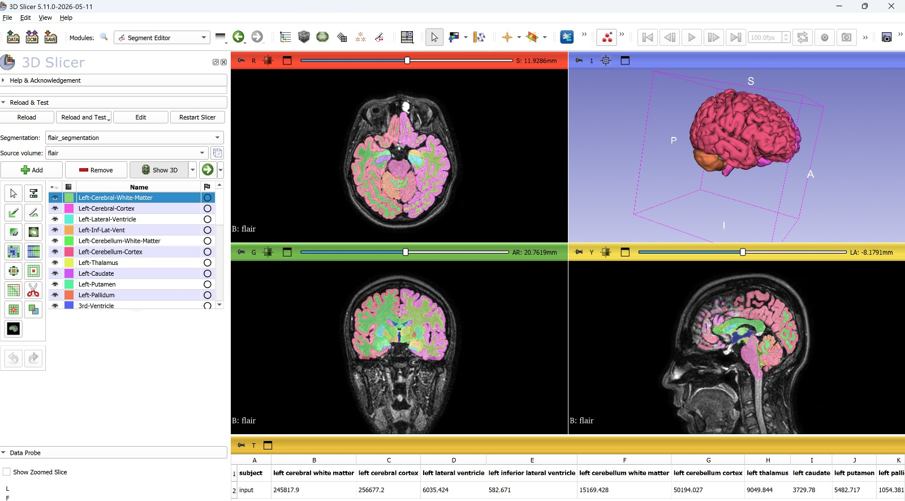

# SlicerSynthSeg


3D Slicer extension for automated brain MRI segmentation using SynthSeg.
Contrast-agnostic (T1, FLAIR, T2). Outputs labeled brain structures + volumes.

## Requirements

- 3D Slicer 5.x
- ~8 GB RAM minimum (16 GB recommended)
- CPU is sufficient (GPU not required)
- Internet access on the first run (TensorFlow, about 600 MB; models, about 50 MB each)

No conda or separate Python installation is needed.

## Installation

### 1. Install the extension in 3D Slicer

- Clone or download this repository
- In Slicer: **Edit > Application Settings > Modules > Additional module paths**
- Add the path to the `SlicerSynthSeg/SlicerSynthSeg` folder
- Restart Slicer

### 2. First run

- Open the **SynthSeg** module (Segmentation category). The status shows **Configured**: the bundled
  `SynthSeg` folder is found automatically.
- Load a volume and click **"Run Segmentation"**. On the first run the extension offers to:
  - install `tensorflow==2.21` and `tf-keras==2.21` into Slicer's Python (once, a few minutes;
    numpy is kept at its current version). SynthSeg then runs in a separate `PythonSlicer` process.
  - download the model files the selected model needs (checked against their SHA-256).

> Results were checked against the original environment (Python 3.8, TensorFlow 2.4.1): on a T1 scan with
> SynthSeg 2.0 + parcellation, 100.0000% voxel agreement and at most 0.007% difference in regional volumes.

> Note: installing TensorFlow can change versions of packages it shares with other extensions
> (in our test, h5py 3.16.0 became 3.14.0; TotalSegmentator and OpenMAP-T1 kept working).
> If another extension stops working after this, please open an issue.

### 3. Advanced: use your own Python / conda environment

If you prefer an existing environment, open **"Configure Environment"**, choose
**"Custom Python / conda environment"** and give its `python.exe`. A working recipe:

```bash
conda create -n synthseg python=3.12 -y
conda activate synthseg
pip install "tensorflow==2.21.*" "tf-keras==2.21.*" scipy nibabel
```

Configurations saved by earlier versions (with a Python path) keep using that Python.

#### Model files

The SynthSeg models are by B. Billot, J.E. Iglesias and colleagues. They are redistributed in the
[models-v1 release](https://github.com/niyaziacer/SlicerSynthSeg/releases/tag/models-v1) of this
repository with the authors' permission (e-mail, 23 October 2026). The extension downloads them from
GitHub, falls back to a Google Drive mirror, and accepts a file only if its SHA-256 matches.

If your network blocks these sites (common on university and hospital networks):

- download the `.h5` files from the release page on another connection, or take them from
  `$FREESURFER_HOME/models` (FreeSurfer 7.3 or later, also inside WSL);
- in **Configure Environment**, click **"Import models from folder"** and choose that folder.
  The files are copied into `SynthSeg/models/`.

### 4. Run segmentation

- Load a T1/FLAIR/T2 brain MRI volume
- Select it as **Input Volume**
- Choose the **Model**:
  - *SynthSeg 1.0*: 32 structures (default, fastest)
  - *SynthSeg 2.0*: adds the extra-ventricular CSF label (24)
  - *SynthSeg 2.0 + cortical parcellation*: also splits the cortex into the 68
    Desikan–Killiany regions. This is the input needed by
    [SlicerCisternaVolumetry](https://github.com/niyaziacer/SlicerCisternaVolumetry).
- Click **"Run Segmentation"**
- Results: labeled segmentation + volume table (mm³)

## Notes

- CPU processing takes a few minutes per scan
- Models are downloaded on first use (not included in the repository because of their size)
- The exported volume table names the input volume and adds the model used and the SynthSeg citation to every row
- Segments are automatically named (Left-Thalamus, Right-Caudate, etc.)

## License & Acknowledgements

This extension (SlicerSynthSeg module code) is released under the MIT License.

It bundles SynthSeg by B. Billot et al., licensed under Apache License 2.0
(see `SynthSeg/LICENSE.txt`). The SynthSeg source and per-file copyright headers
are preserved unchanged.

Original SynthSeg repository: https://github.com/BBillot/SynthSeg

If you use this tool in research, please cite:

> Billot B, Greve DN, Puonti O, Thielscher A, Van Leemput K, Fischl B, Dalca AV,
> Iglesias JE. "SynthSeg: Segmentation of brain MRI scans of any contrast and
> resolution without retraining." Medical Image Analysis, 2023.

If you use SynthSeg 2.0 cortical parcellation, please also cite:

> Billot B, Colin M, Cheng Y, Arnold SE, Das S, Iglesias JE. "Robust machine learning
> segmentation for large-scale analysis of heterogeneous clinical brain MRI datasets."
> PNAS, 2023.

## Author

Prof. Dr. Niyazi Acer (Retired, Erciyes University)
